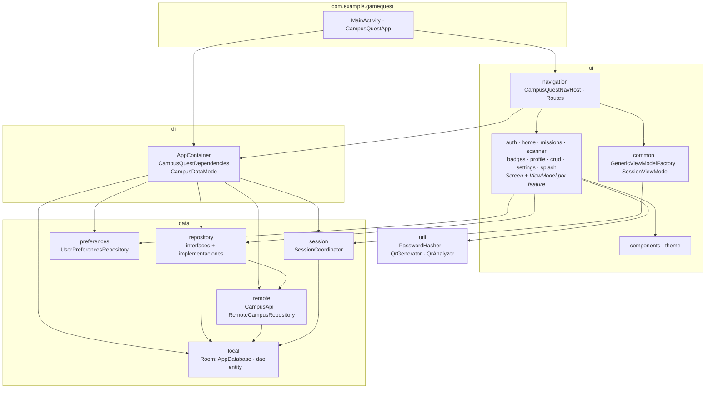

# Arquitectura de Campus Quest

Campus Quest sigue la [guía de arquitectura de apps de Android](https://developer.android.com/topic/architecture):
**MVVM** con una capa de UI y una capa de datos, flujo unidireccional de datos y
dependencias creadas en un único contenedor manual. Este documento describe la
organización de paquetes y las reglas que la mantienen.

## Diagrama de paquetes

Las flechas indican "importa a". El diagrama se obtuvo de los `import` reales del
código fuente (`app/src/main/java/com/example/gamequest`).

## Capas

### UI (`ui/`)

- Cada feature tiene su `Screen` (Compose) y su `ViewModel`.
- **State hoisting:** ninguna pantalla recibe un ViewModel. Recibe el estado ya leído
  y lambdas de evento (en las pantallas con muchos eventos, agrupadas en una clase
  `@Immutable`, por ejemplo `ProfileEventos` y `MissionFormEventos`).
- `CampusQuestNavHost` es el único archivo que obtiene ViewModels (`viewModel(factory = …)`)
  y recoge su estado con `collectAsStateWithLifecycle()`, de modo que la recolección se
  detiene cuando la app pasa a segundo plano.
- Cada ViewModel guarda un `MutableStateFlow` **privado** y expone un `StateFlow`
  inmutable; las operaciones se lanzan en `viewModelScope`.
- La UI solo importa del paquete `data` las interfaces de repositorio, las entidades
  (usadas como modelos de lectura) y `SessionCoordinator`. Nunca importa DAOs,
  `AppDatabase` ni clases de `data/remote`.

### Datos (`data/`)

| Interfaz | Implementación | Fuente |
|---|---|---|
| `CampusRepository` (extiende `CampusDataRepository`) | `OfflineFirstCampusRepository`, `RemoteCampusRepository` | Room + API REST |
| `AuthRepository` | `DefaultAuthRepository` | Room |
| `UserPreferencesRepository` | `DataStoreUserPreferencesRepository` | DataStore |
| `TutorSetupRepository` | `LocalTutorSetupRepository` | Room |

- **Room es la fuente única de verdad.** En modo remoto, `RemoteCampusRepository`
  sincroniza el catálogo y el progreso contra la API y los guarda en Room; la UI
  siempre observa los `Flow` de Room, así que funciona sin conexión.
- **Concurrencia:** cada implementación recibe un `ioDispatcher: CoroutineDispatcher`
  (por defecto `Dispatchers.IO`). Los `Flow` usan `.flowOn(ioDispatcher)` y las
  funciones `suspend` usan `withContext(ioDispatcher)`, de modo que ninguna lectura o
  escritura bloquea el hilo principal. Los tests inyectan un dispatcher propio y
  comprueban en qué hilo se ejecutó el trabajo (`CampusRepositoryTest`).

### Inyección de dependencias (`di/`)

- `AppContainer` se crea una vez en `CampusQuestApp` y construye cada dependencia una
  sola vez, incluido el `ioDispatcher` compartido.
- La UI depende de la interfaz `CampusQuestDependencies`, no de `AppContainer`; en las
  pruebas instrumentadas se usa `FakeCampusQuestDependencies`.
- `GenericViewModelFactory` recibe una lambda que construye el ViewModel con sus
  dependencias explícitas. No hay localizador de servicios: ningún ViewModel ni
  pantalla busca el contenedor por su cuenta.

### Capa de dominio

No se incluye. La guía de la asignatura la deja como opcional, para lógica compleja
reutilizada entre varios ViewModels. En Campus Quest cada regla de negocio (validar un
QR, crear o eliminar una misión, permisos del tutor) la invoca un solo ViewModel y vive
en el repositorio correspondiente.

## Reglas verificadas automáticamente

| Regla | Dónde se comprueba |
|---|---|
| Ninguna pantalla `@Composable` recibe un ViewModel | `StateHoistingArchitectureTest` |
| Los repositorios ejecutan su trabajo en el dispatcher inyectado | `CampusRepositoryTest` |
| La app compila, pasa lint y las pruebas en API 29 y 35 | CI de GitHub Actions |
